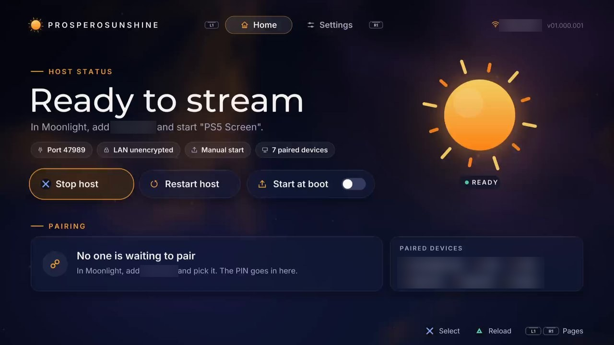
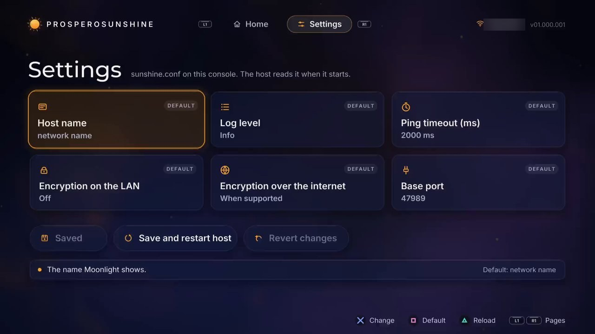

# ProsperoSunshine


A native, Sunshine-compatible game-stream host for the PlayStation 5. Add your console to Moonlight and stream
the PS5 screen, game audio and controller input over your LAN.

> **Status: 0.1.6 ([changelog](CHANGELOG.md)).** Pairing, H.264, HEVC and HDR up to 4K at 30 or 60 fps, game audio and controller input work end to end
> with Moonlight on PC, in the browser (Moonlight Web) and on iPhone. Sessions of 30 minutes and ten reconnects
> were tested without errors. Only firmware 13.00 has been tested so far. Not every client or game has been tried.

## How it works

ProsperoSunshine builds [Sunshine](https://github.com/LizardByte/Sunshine) (pinned commit, small documented
patches) for the console and replaces the parts that talk to PC hardware:

- **Video:** the console's hardware encoder (Avcap2) delivers H.264 or HEVC, 8 bit or HDR, straight into Sunshine's packetiser.
- **Audio:** game audio as PCM from the same capture service, encoded by Sunshine's Opus path.
- **Input:** a native virtual DualSense per Moonlight gamepad, with touchpad and motion sensors.
- **App list:** "PS5 Screen" and the console's installed games, with their covers. There is no web UI.

Details: `docs/adr/001-sunshine-port.md`. Roadmap: `ROADMAP.md`; verified state: `STATUS.md`;
reverse-engineering notes: `docs/` (German).

## Requirements

- PS5 firmware: **13.00 and 10.20 are tested** (10.20 at 1080p, where the encoder keeps its own bitrate). Other versions are
  untested; the host refuses them only if its system-library lookups fail (`docs/firmware-porting.md`, German).
- A homebrew environment with an **ELF loader** (for example one listening on port 9021). The app also needs
  [ShadowMountPlus](https://github.com/drakmor/ShadowMountPlus), which registers titles from `/data/homebrew/`.
- No PS VR session while streaming.
- A wired or good wireless LAN, and a Moonlight client in the same network.

## Install

**Option A: the PS5 app "ProsperoSunshine" (`PPSA47989`).** The app carries the host and offers start/stop,
autoload through the Payload Manager, settings and PIN entry. Install it from ProsperoStore, or copy the folder from
`PPSA47989.zip` (GitHub release) to `/data/homebrew/`. Details: `app/README.md`.

| Home | Settings |
| --- | --- |
|  |  |

**Option B: send the ELF manually.** Send `prospero_sunshine.elf` (from a release, or `out/` after building) to your
ELF loader. The host keeps its state (identity, paired clients, `sunshine.conf`) in `/data/prosperosunshine/`.
To replace a running host, stop it first (app: "Stop host"); a second ELF cannot bind the ports and exits, and the
old host keeps running.

## Pairing

1. In Moonlight, pick the console, or add it by its IP address (`<console-ip>`), and start pairing. Moonlight shows a PIN.
2. Enter the PIN in the ProsperoSunshine app on the PS5 (option A).
3. Without the app, approve it through the control socket from the same machine, or from the LAN if you enabled it
   (see below): `printf 'PIN 1234\n' | nc <console-ip> 47995`.

Pairing survives host restarts.

## Streaming

Start **"PS5 Screen"** in Moonlight to stream what the console shows, or pick a game to start it as well. The first time, the
console asks **"Who's using this controller?"** inside the stream; answer it with your Moonlight controller.

By default the host never closes a game, because that could lose unsaved progress. Quitting in Moonlight ends the stream, and
the game keeps running on the console. If another game is open, in front or behind the settings app, picking a game fails
(Moonlight reports error 409) and starts nothing: close the running game first, on the console or in a "PS5 Screen" stream,
then pick the game again. Media apps aren't listed; start those through "PS5 Screen".

**Closing the game from Moonlight:** with `close_game_on_quit = enabled` in `sunshine.conf`, the host behaves like Sunshine on
a PC for the game the stream started, or the one already in front when you picked it. After the stream it stays listed as
running while it is in front, so Moonlight offers to resume or quit it, and picking another game asks to quit it first.
Quitting closes it as "Close Game" on the console does, and unsaved progress is lost. On Moonlight for PC, the stop button on
the running game quits it; so does Ctrl+Alt+Shift+E during the stream, which doesn't ask and also closes Moonlight, or any end
of the stream when "Quit app on host PC after ending stream" is on. With that option off (Moonlight's default),
Ctrl+Alt+Shift+Q only ends the stream and the game keeps running. "PS5 Screen" closes nothing.

**PS button:** Moonlight's on-screen controller on a phone has none, so holding Select for half a second sends it. A
short press of Select sends Create when you let go, which means Create cannot be held. To get a plain Create button
back, set `back_button_timeout = -1` in `sunshine.conf`; a value of 0 or more is the hold time in milliseconds.

## Known limits

- On firmware 13.00, H.264 and HEVC stream at 1080p, 1440p or 4K, whichever the client asks for. Every other
  firmware stays at 1080p. A client asking for less than 1080p gets 1080p and scales it. The frame rate follows the client:
  30 or 60 fps.
- The console refuses 1440p and 4K capture in some titles (seen in a Mario 64 port and Teardown; GTA III works). The stream
  then runs at 1080p, also when such a title starts during a stream, and stays there until the next stream. The same should
  apply when the console's video output is smaller than the request; that is not tested yet.
- At 4K the console can show "Gameplay recording paused because you entered a blocked scene" shortly after the stream starts
  (seen in GTA III). The stream keeps running.
- HEVC and HDR are offered on firmware 13.00 and 10.20, elsewhere H.264. Clients that prefer HEVC pick it on their own. To
  force H.264, choose it in Moonlight's settings or set `hevc_mode = 1` in `sunshine.conf`; `hevc_mode = 2` keeps HEVC
  and turns HDR off.
- The bitrate is capped at 50 Mbit/s. The encoder holds it in normal scenes, but extreme images can exceed it: full-screen
  random noise reached about 130 Mbit/s at 4K and 35 Mbit/s at 1080p, whatever was set.
- One streaming session at a time. More than one Moonlight controller is untested.
- Without `close_game_on_quit`, Moonlight for PC can still offer to quit a game from its app list, also when you pick another
  game, but that sends nothing to the host: it reports no running game once the stream has ended, so Moonlight skips its quit
  request and waits at "Quitting…" until it is restarted. Close the game on the console instead. Other clients are untested.
- A real DualSense disconnects when the stream controller connects. Turned back on during the stream it stays without
  effect, because apps read only the controller that connected first; after the stream it works normally. The other way
  round, a controller that is already connected and not disconnected (seen with a second virtual pad) keeps the app, and
  only the console's home screen still reacts to Moonlight. If the stream controller does nothing in an app, turn the
  other controller off.
- No AV1, mouse, keyboard, touchscreen or microphone.
- HDR has been seen on one real setup so far: Moonlight on an HDR TV, 4K, one game. The capture provides no HDR metadata, so the
  host sends none, and other screens may handle that differently.
- The pad's touchpad and motion sensors are measured with the test client only, not yet with a real Moonlight client or in a game
  that uses them. Motion has no orientation, because Moonlight sends none.
- Rumble is the classic two-motor kind only. Games that drive the DualSense's haptics send nothing to your controller.
  Whether your device vibrates also depends on the Moonlight client.
- Rest mode is young. The host starts its services again after waking, which worked in two tests on the home screen, with no
  game open and no stream running. With a game open and a stream running, the console and the game came back in one test, but the
  host stayed unreachable until it was restarted. In an earlier test without this, the console hung after waking and had to be
  switched off at the power button; the cause is unknown. To be safe, turn the console off instead.
- Adaptive triggers work with Moonlight on a PC and a DualSense; other clients ignore them. Only Teardown has been tested. If a stream
  ends during an effect, the trigger stays stiff until you connect again, because Moonlight doesn't reset it.
- Waking the console from Moonlight did not work in the one try, from a PC in the same network. The host gives paired clients the
  console's MAC address, but the console stayed in rest mode.
- Starting or quitting a game briefly takes the capture resource away: video and audio pause for about 2 seconds
  and then resume on their own.
- After a hard network drop, held controller input is released after about 2 seconds.

## Troubleshooting

- **Moonlight cannot find the console:** Moonlight normally lists it on its own (mDNS, confirmed on iPhone). If not, for
  example because the network blocks multicast, add it by IP.
- **Connection fails or stalls:** make sure nothing blocks TCP 47984, 47989, 48010 and UDP 47998-48000 between the
  client and the console (client or router firewall).
- **iPhone:** works. An earlier bug (sound but no picture, because the host announced HEVC) is fixed.
- **Black or paused picture for a moment:** expected when a game starts or exits (see limits).
- **Controller works on the home screen but not in an app:** turn off other controllers connected to the console (see
  limits).
- **Other firmware:** 13.00 and 10.20 are tested. On other versions capture is refused if the system-library lookups fail;
  if they succeed it runs, untested. The kernel log says which case applies.
- **Diagnosis:** the app's **Diagnostics** page collects a report for a bug report, without addresses, device names or
  ids. While the page is open and the host runs, a phone or PC in the same network can open it at
  `http://<console-ip>:47996`; it is also saved as `/data/prosperosunshine/diagnostics.txt`. For more detail, set `min_log_level = debug` in
  `/data/prosperosunshine/sunshine.conf`; messages go to the kernel log and `sunshine.log`.

## Development control socket

The host listens on TCP **47995** with a line-based control socket: `STATUS`, `PAIRINGS`, `PIN [<id>] <pin> [name]`,
`REPORT`, `AUTOLOAD [ON|OFF]` and `QUIT`. It is **unauthenticated**. By default it listens on `127.0.0.1` only (ROADMAP P9.1), so the app on the
console can use it but the LAN cannot. Creating the empty file `/data/prosperosunshine/control_lan` re-enables LAN
access for development. Do this only on trusted networks.

## Building from source

Requires Docker. The image contains LLVM 18 and the
[PS5 Payload SDK](https://github.com/ps5-payload-dev/sdk) v0.45 (hash-checked); all third-party sources are pinned
with SHA256 in `deps.lock`.

```powershell
powershell -NoProfile -ExecutionPolicy Bypass -File scripts/build.ps1
```

The first run builds the dependencies into `out/deps` (around 30 minutes, mostly Boost). The host is
`out/prospero_sunshine.elf`; the other ELFs are hardware probes. `app/build.ps1` then builds the app, and
`bash scripts/package.sh` the release archive. Portable unit tests:

```sh
docker run --rm --mount type=bind,source="$PWD",target=/repo prosperosunshine-sdk:v0.45 bash scripts/test.sh
```

An automated Moonlight-protocol test client (pairing, smoke test, reconnects, packet loss, A/V sync) is in
`tools/moonlight/`.

## License

GPL-3.0-only, like Sunshine, which this project builds on (`LICENSE`). Third-party components, their licences and
the patches applied to them are listed in `docs/licenses.md`; what a release must bundle is in `docs/THIRD_PARTY.md`.
The build installs third-party licence texts to `out/deps/licenses`.
